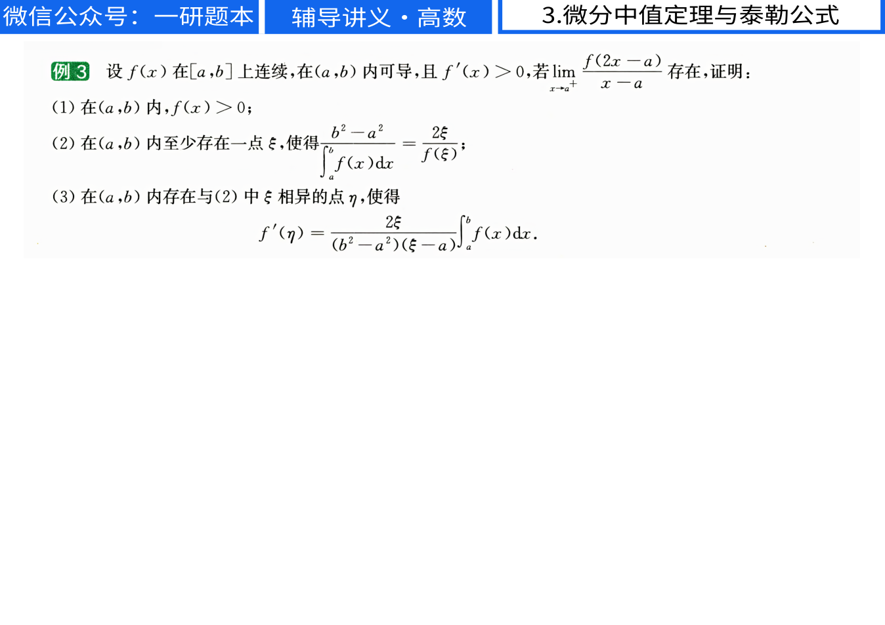
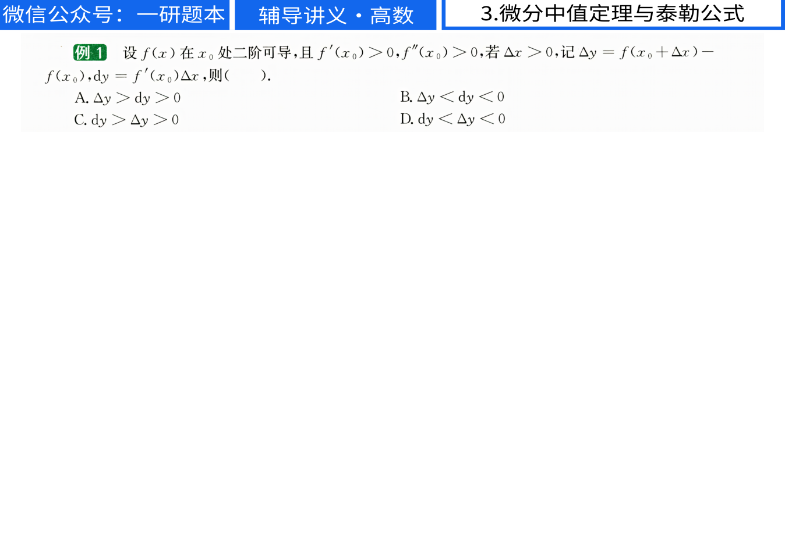
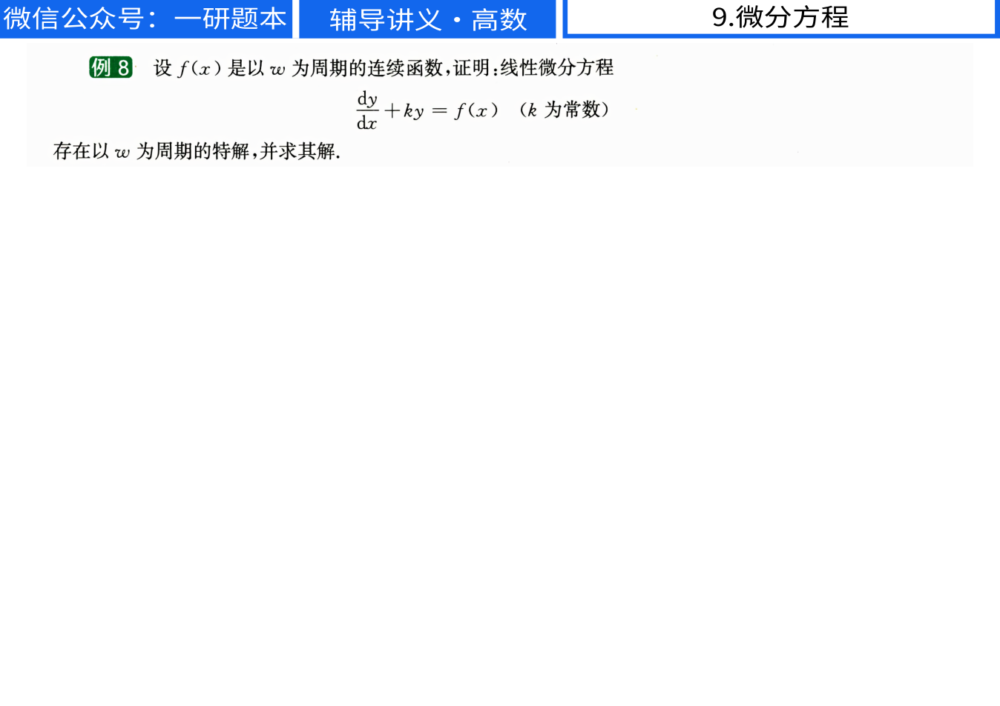
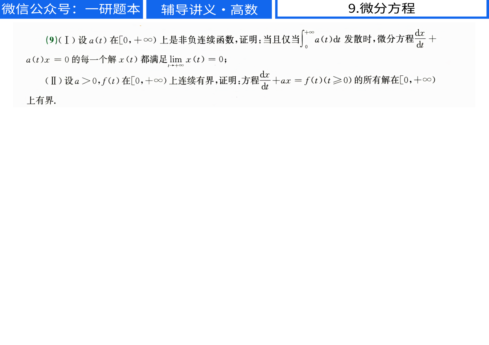

# 李林讲义条件疑点原页核对

2026-11-13 核对。源文件为 references/27李林880/【做题本】平板版27考研李林辅导讲义（高数）.pdf。以下图片由对应 PDF 原页新生成，分辨率均为 1348 × 953 像素，文件均非空。此次检查原始题面。

涉及解析文件为 .question-bank-work/lilin-ipad-ode.txt、.question-bank-work/lilin-ipad-limits.txt。原题面在统一生成器中修订。

## 原 PDF 第158页

对应 Markdown 第1046行。第（3）问确实含有分母 b²−a²，原题没有排除 b²=a²。解析保留这一条件说明，并给出不依赖该除法的割线斜率版本。

## 原 PDF 第159页

对应 Markdown 第1058行。原题给定一点处的一阶、二阶导数为正，且只写 Δx>0。原题没有写“充分小”。解析明确所选 A 的局部适用条件，并用多项式反例检查大增量的情况。

## 原 PDF 第440页

对应 Markdown 第2650行。参数 k 只注明为常数，未注明非零。解析给出非零参数的周期解，并说明零参数时需一周期积分为零。

## 原 PDF 第485页

对应 Markdown 第2904行。第（Ⅱ）问明确为 a>0。解析使用这个正参数条件证明所有解有界。

