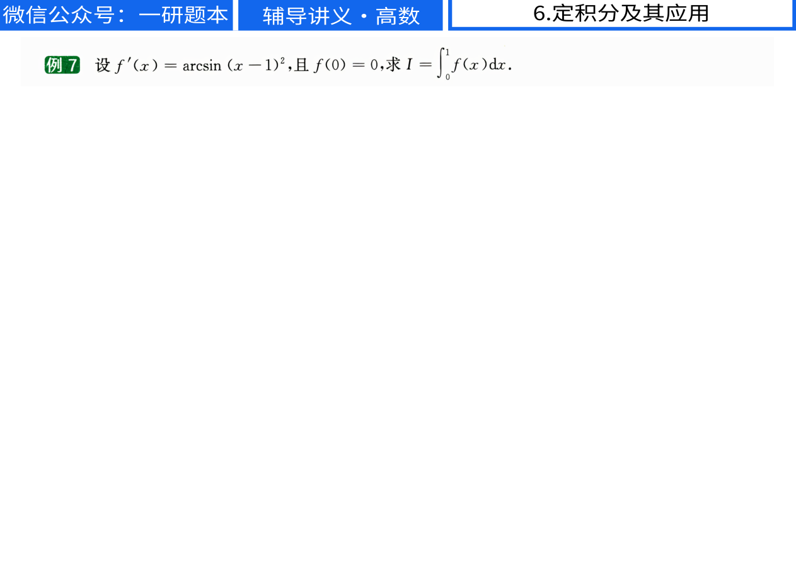
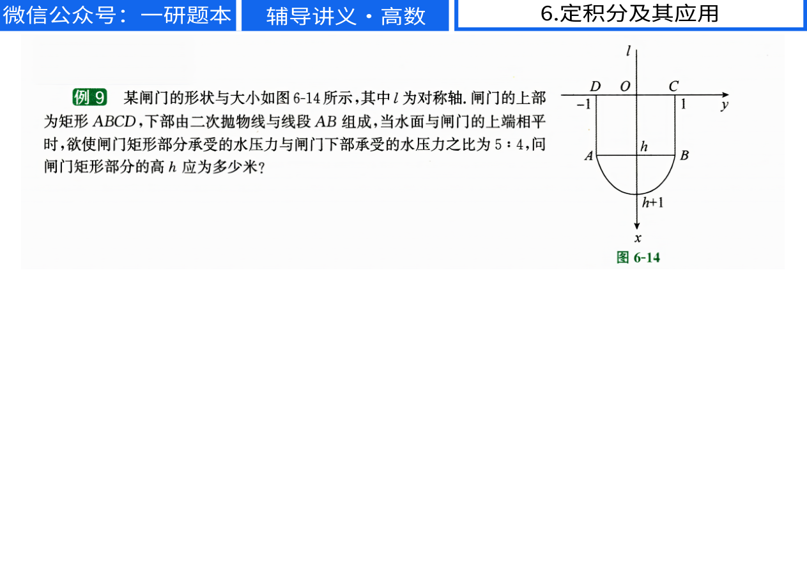
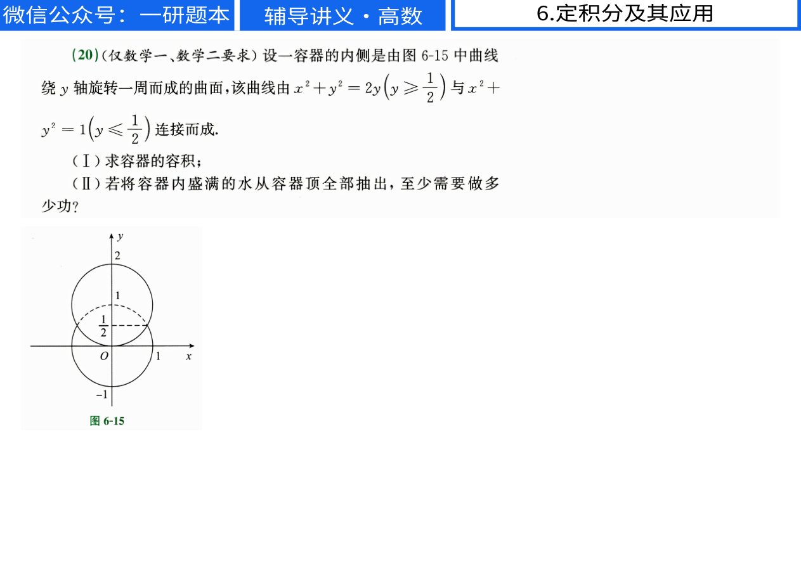

# 李林高数第5–6章原题图像核对

输入为 [李林高数做题本原 PDF](../../references/27李林880/【做题本】平板版27考研李林辅导讲义（高数）.pdf)，题面定位使用 [已校对 Markdown](../../references/27李林880/md/【做题本】平板版27考研李林辅导讲义（高数）.md)。六张图均由本次直接渲染原 PDF 生成，已逐张打开检查，文件非空。PDF 页面尺寸为 841.89×595.276 bp，渲染比例为 1.5，图片尺寸均为 1263×893 像素。本记录覆盖原题公式与图中条件核对，交付源稿为 [李林高数上册分节题集](../../output/李林高数上册分节题集.tex)。

| 原 PDF 页码 | 图片文件 | 观察结果 |
| --- | --- | --- |
| 232 | lilin-integrals-source-232.png | max 位于积分号右侧，最大值函数是被积函数。交付题面写作 $\int\max\{x^3,x^2,1\}\,dx$。 |
| 261 | lilin-integrals-source-261.png | 平方位于 $(x-1)$ 的右上方，反正弦的自变量为 $(x-1)^2$。交付题面用显式括号澄清分组。 |
| 279 | lilin-integrals-source-279.png | 平方位于 $(u-t)$ 的右上方，正弦的自变量为 $(u-t)^2$，分母为 $x^8$。 |
| 298 | lilin-integrals-source-298.png | 第一问分母是 $\sqrt{|x-x^2|}$，根号内没有额外的数字 1。第二问分母是 $x\sqrt{x-1}$。 |
| 311 | lilin-integrals-source-311.png | 矩形左右边界水平坐标为 −1、1，矩形高度为 $h$，抛物线顶点深度为 $h+1$。据此建立下部宽度及水压力积分，得到 $h=2$。 |
| 340 | lilin-integrals-source-340.png | 容器顶端高度为 2、底端为 −1，两圆弧接合高度为 $\frac12$。体积积分在 $\frac12$ 分段，抽水提升距离为 $2-y$。 |

