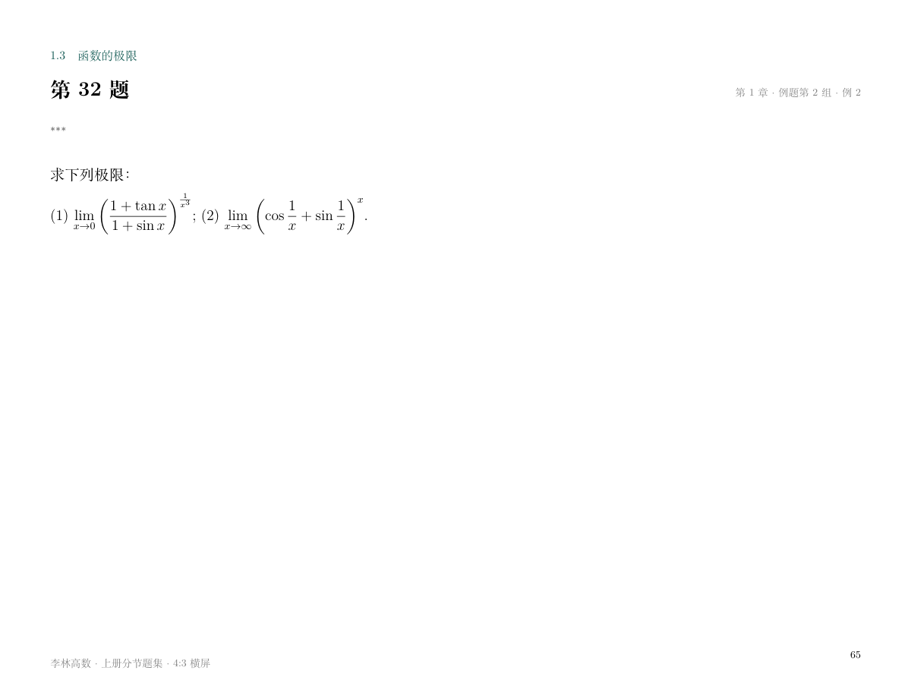

# 李林高数上册分节题集检查

2026-11-14。用户已明确授权查看原题图并检查 PDF 排版。涉及文件：`output/李林高数上册分节题集.tex`、同名 PDF 及 `output/lilin-figures/`。最终 PDF 共858页，页面为800×600bp，以下七张最终渲染图本轮重新生成，均为1200×900像素，非空，均已打开检查。原题疑点图片沿用2026-11-13核对记录。

## 最终 PDF

| 页面 | 图片 | 观察结果 |
| --- | --- | --- |
| 目录，第1页 | [目录](lilin-ipad-contents.png) | 四章19节目录、题数与说明均在同页，页脚完整。 |
| 第32题，第65页 | [极限题](lilin-ipad-question.png) | 三星独立排在题号下方、题干上方，小号灰字。分数上下排列，lim条件位于下方；题下留白，未出现解析。 |
| 第32题解析，第66页起 | [解析](lilin-ipad-solution.png) | 已知与目标、方法和分步推导清楚；长解析续页，公式、文字和页眉页脚均在页面内。 |
| 第192题，第391页 | [图题](lilin-ipad-graph-question.png) | 两星小灰字独立成行；原导函数曲线可辨认，选项与图示完整，下方留有手写区域。 |
| 第192题解析，第392页 | [图题解析](lilin-ipad-graph-solution.png) | 四部分解析完整，逐个检查导数变号及零点接合点，与题页分开。 |
| 第348题续页，第712页 | [积分解析](lilin-ipad-long-solution.png) | 对称换元、积分上下限、分部及链式求导均逐步说明，无重叠或截断；页眉标明同号解析。 |
| 第217题，第441页 | [留白最少题页](lilin-ipad-dense-question.png) | 三星单独小灰字行，曲线和选项可辨认，题下仍留117.7bp空白。 |

全部页面另用文字和图形坐标检查题解对应、800×600bp尺寸、内容边界及24个书签；419道题的星号均为9pt灰字，单独位于题号与题干之间。编译日志无缺字、警告或溢出。渲染抽查不代表iPad实机测试，也不代替数学推导复核。

## 原题疑点

以下图片来自讲义原 PDF，均为 842×596 像素，非空。对应文件为生成后的 LaTeX 题面及解析。

- [原第77页](lilin-condition-source-77.png)：分段函数右支分母为四分之一乘以 x²；据此恢复题面，连续参数为 −1。
- [原第164页](lilin-condition-source-164.png)：右端确为三阶导数；题面保留第三撇，解析使用Taylor公式与介值定理证明。
- [原第469页](lilin-condition-source-469.png)：方程为三阶线性方程；恢复各项正确阶数。

其余条件疑点见 [微分方程原页记录](lilin-condition-ode-review.md)，积分公式与几何图形见 [积分原页记录](lilin-integrals-source-review.md)。
