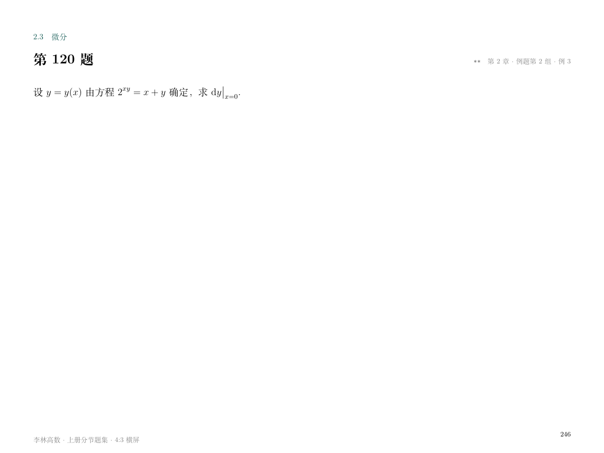

# 李林高数上册分节题集检查

2026-11-14。检查了李林高数上册分节题集的 LaTeX 源稿和同名 PDF。PDF 共 858 页，页面为 800×600 bp，渲染图均为 1200×900 像素。本轮查看了第 32、120、192、217 题的渲染图。

## 最终 PDF

| 页面 | 图片 | 观察结果 |
| --- | --- | --- |
| 目录，第1页 | [目录](lilin-ipad-contents.png) | 四章19节目录、题数与说明均在同页，页脚完整。 |
| 第32题，第65页 | [极限题](lilin-ipad-question.png) | 三星小灰字紧靠题源左侧，与题号同行。分数上下排列，lim 条件位于下方。 |
| 第120题，第246页 | [用户标注的题页](lilin-ipad-question-120.png) | 两星小灰字位于截图红框所指的题源左侧。 |
| 第32题解析，第66页起 | [解析](lilin-ipad-solution.png) | 已知与目标、方法和分步推导清楚；长解析续页，公式、文字和页眉页脚均在页面内。 |
| 第192题，第391页 | [图题](lilin-ipad-graph-question.png) | 两星小灰字与题源同行，选项与图示完整。 |
| 第192题解析，第392页 | [图题解析](lilin-ipad-graph-solution.png) | 四部分解析完整，逐个检查导数变号及零点接合点，与题页分开。 |
| 第348题续页，第712页 | [积分解析](lilin-ipad-long-solution.png) | 对称换元、积分上下限、分部及链式求导均逐步说明，无重叠或截断；页眉标明同号解析。 |
| 第217题，第441页 | [留白最少题页](lilin-ipad-dense-question.png) | 三星小灰字位于右侧，曲线和选项可辨认，题下留白 149.6 bp。 |

逐页坐标检查确认 419 道题的星号均为 9 pt 灰字，与题号和题源同行。24 个书签、题解分页及内容边界检查通过，编译日志无缺字、警告或溢出。

## 原题疑点

以下图片来自讲义原 PDF，均为 842×596 像素，非空。对应文件为生成后的 LaTeX 题面及解析。

- [原第77页](lilin-condition-source-77.png)：分段函数右支分母为四分之一乘以 x²；据此恢复题面，连续参数为 −1。
- [原第164页](lilin-condition-source-164.png)：右端确为三阶导数；题面保留第三撇，解析使用Taylor公式与介值定理证明。
- [原第469页](lilin-condition-source-469.png)：方程为三阶线性方程；恢复各项正确阶数。

其余条件疑点见 [微分方程原页记录](lilin-condition-ode-review.md)，积分公式与几何图形见 [积分原页记录](lilin-integrals-source-review.md)。
